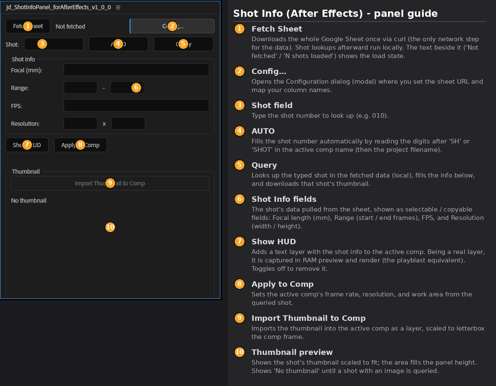
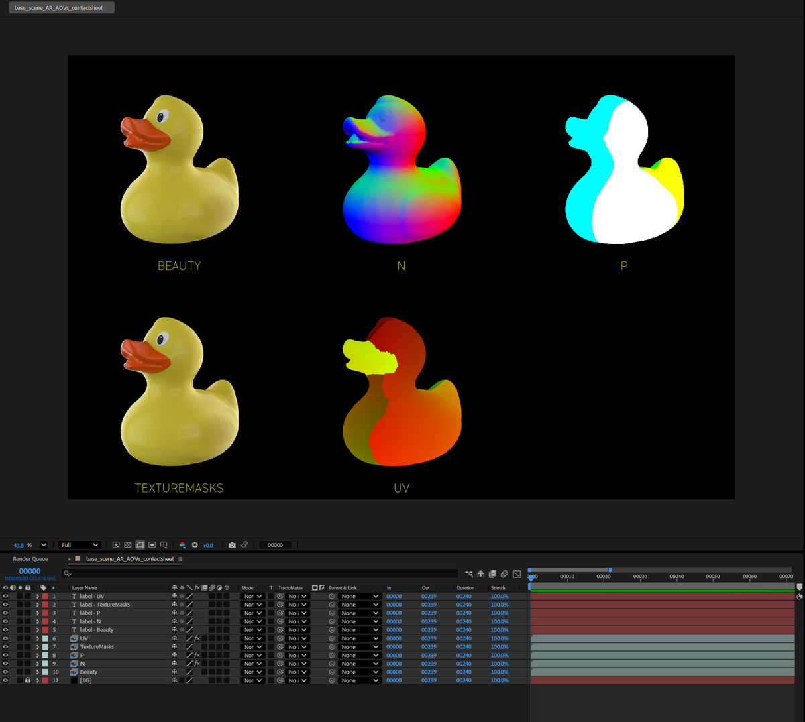
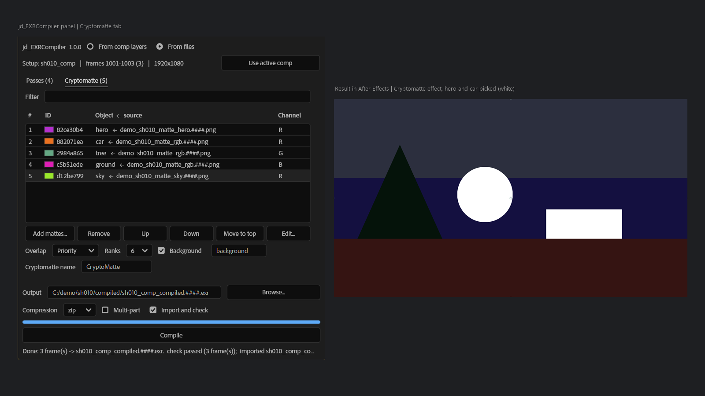
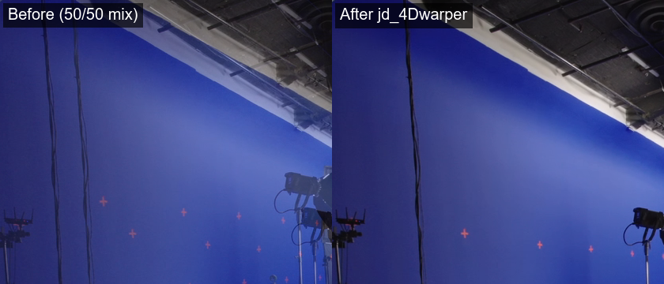

# aftereffects_tools

Public collection of After Effects scripts and panels. Some by myself, some with ai help.

Each tool lives in its own subfolder and is self-contained. **Panels** go in After
Effects' `Scripts/ScriptUI Panels/` folder — restart, then open from the
**Window** menu. **Scripts** go in `Scripts/` and run from **File → Scripts**.
**Plug-ins** (`.aex`) go in any folder under After Effects' `Plug-ins/` folder — restart, then
find them in the **Effect** menu.
Some tools ship extra assets alongside the `.jsx`; see each tool's own README for
usage and requirements.

## Tools

| Tool | Type | Description | Version |
|------|------|-------------|---------|
| [jd_ShotInfoPanel_forAfterEffects](jd_ShotInfoPanel_forAfterEffects/) | Panel | Pulls per-shot data (thumbnail, camera focal length, frame range, fps, resolution) from a Google Sheet into a dockable panel, with a comp HUD and thumbnail import. | 1.0.0 |
| [jd_AOVcontactsheet](jd_AOVcontactsheet/) | Script | Builds a labelled contact sheet comp of a render's AOVs — from one multi-layer EXR, or from a set of separate per-AOV files. Ships with 129 animation presets. | 1.1.0 |
| [jd_EXRCompiler](jd_EXRCompiler/) | Panel + CLI | Merges render passes into one multi-layer EXR and builds a spec-exact Cryptomatte from black-and-white or RGB mattes or comp layers, which AE can't write itself. Windows. | 1.0.1 |
| [jd_4Dwarper](jd_4Dwarper/) | Plug-in | Conforms one motion-control pass to another in time and space, following the set; the talent can be masked out. Windows. | 0.3.5 |

<!-- Add new tools as rows above. -->

## At a glance

### [jd_ShotInfoPanel_forAfterEffects](jd_ShotInfoPanel_forAfterEffects/)
Per-shot data from a Google Sheet in a dockable panel: thumbnail, camera, frame range, comp HUD.
[README](jd_ShotInfoPanel_forAfterEffects/)

### [jd_AOVcontactsheet](jd_AOVcontactsheet/)
A labelled contact sheet comp of every AOV in a render, from one multi-layer EXR or separate files.
[README](jd_AOVcontactsheet/)

### [jd_EXRCompiler](jd_EXRCompiler/)
Merge passes into one multi-layer EXR, and build a spec-exact Cryptomatte from mattes. Windows.
[README](jd_EXRCompiler/) · [Download 1.0.1](https://github.com/jdel0nAY/ae-tools/releases/tag/jd_EXRCompiler-v1.0.1)

### [jd_4Dwarper](jd_4Dwarper/)
Conform one motion-control pass to another in time and space, following the set. Windows.
[README](jd_4Dwarper/) · [Download 0.3.4](https://github.com/jdel0nAY/ae-tools/releases/tag/jd_4Dwarper-v0.3.4)

## License

[MIT](LICENSE) — applies to everything in this repository unless a subfolder
states otherwise.
