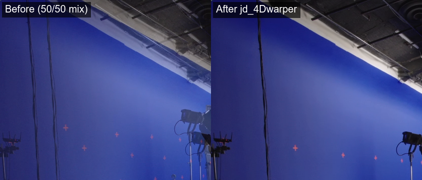
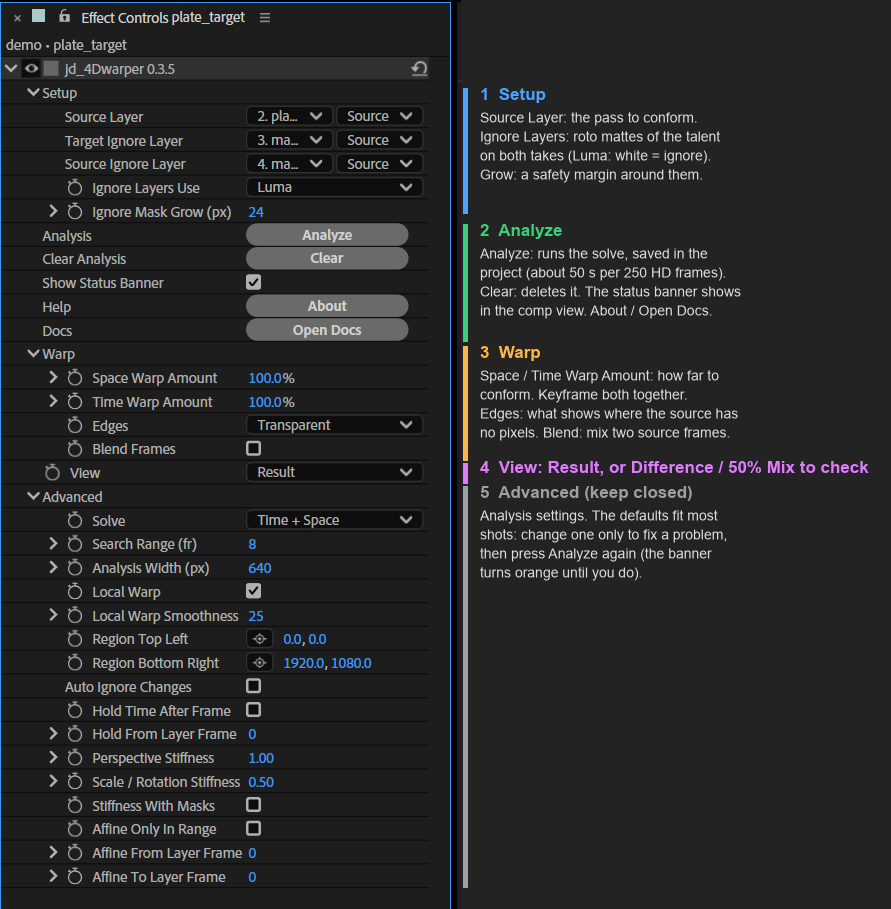
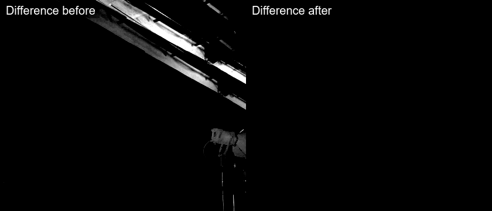
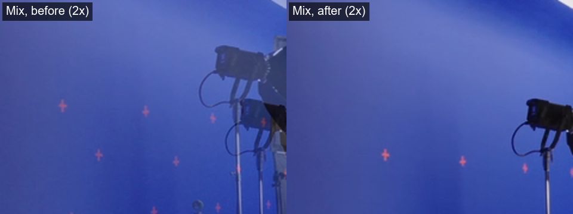

<!--
Images in docs/images/ (public repo: blue-screen set corners only; NO talent,
NO people, NO product anywhere):
  hero_before_after.png        test shot frame 20, left blue wall only (markers, cables, a light stand), 50/50 mix
  mix_before_after.png         same frame, 2x detail of markers and the light stand
  difference_before_after.png  same crop, grey difference with the target
  panel-guide.png              After Effects Effect Controls (UI only, renamed layers), annotated
Before adding an image: no people, no product, no client or footage names, no local paths.
-->
# jd_4Dwarper

**An After Effects effect that conforms one motion-control pass to another, in time and space.**

Two passes of the same move never line up exactly: the rig drifts, the timing slips by a fraction of a frame, the
lens breathes. jd_4Dwarper measures the **set** in both passes and warps the source pass onto the target pass, frame
by frame. Talent and anything you roto out are ignored.

## Features
- **Time**: a sub-frame offset per frame, which may drift along the shot.
- **Space**: a homography per frame, plus a smooth local warp for parallax.
- **Follows the set**: roto the talent on both takes and it is left out of the solve.
- **Robust to lighting changes** between takes.
- **Space Warp Amount / Time Warp Amount**: keyframable, to ease in and out of the conform.
- **Clear status**: a banner in the comp view says if the layer is ready, needs a new Analyze, or why it failed.
- **Fast and safe to render**: 8, 16 and 32 bpc, multi-frame rendering. The analysis is saved in the project and
  does not depend on resolution: analyse a proxy, render the full-resolution plate.

## Requirements
- After Effects 2026, Windows 10 or 11, x64.
- Two passes of the same move, the same pixel size (precompose the source if not).
- Analyze takes about 50 seconds for 250 HD frames on a 24-thread CPU (about 60 the first time, while After
  Effects reads the footage).

## Install
1. Close After Effects.
2. Copy `jd_4Dwarper.aex` into any folder under `C:\Program Files\Adobe\Adobe After Effects 2026\Support Files\Plug-ins\`.
   Remove any older `4Dwarper.aex` (0.3.3 and before) from the Plug-ins folder.
3. Start After Effects. The effect is in **Effect > JD tools > jd_4Dwarper**. Projects made with 4Dwarper 0.3.x open
   with their settings and analysis: the effect is the same, only its name changed.

## Usage
1. Put both passes in one comp. Apply **jd_4Dwarper** to the **target** layer.
2. **Setup > Source Layer**: pick the other pass. Turn off the source layer's eye.
3. People in shot? Roto them on both takes and pick the mattes as **Target Ignore Layer** and **Source Ignore Layer**.
4. Press **Analyze**. The banner turns green: "ready".
5. **View > Difference (exposure matched)**: black means aligned. Set it back to **Result** to render.

Set the Source Layer's out point before any frame that is not real footage (a dissolve, a cut). Where the target
needs frames past it, the last one is held; the banner turns amber and says for how many frames.

## Effect controls

| Group | Controls |
|---|---|
| Setup | Source Layer, Target / Source Ignore Layer, Ignore Layers Use, Ignore Mask Grow |
| Analyze | Analyze, Clear, Show Status Banner, About, Open Docs |
| Warp | Space Warp Amount, Time Warp Amount, Edges, Blend Frames |
| View | Result, Difference (exposure matched), 50% Mix, Difference (plain), Ignored Zones |
| Advanced | Solve, search range, analysis width, local warp, region, hold, stiffness, affine range |

Every control is explained in the [user guide](docs/USER_GUIDE.md).

## Checking the fit
**View > Difference (exposure matched)**: the difference with the target after matching exposure. Black is aligned.

**View > 50% Mix**: half source, half target. Doubled edges mean misaligned; one crisp image means aligned.

## Build
Visual Studio 2022 Build Tools, C++17, no third-party libraries. The After Effects SDK is not included (Adobe
licence): download it from Adobe and set the `AE_SDK` environment variable to its `Examples` folder (or put that
path in a `local_sdk.txt` next to `build.bat`). Then run `build.bat`. Without the SDK the tools and tests still
build; CMake warns that the effect is skipped. Tests: [docs/TESTING.md](docs/TESTING.md).

| Folder | What is in it |
|---|---|
| `src/` | The analysis (shared by the effect and the tools) and the render core |
| `ae/` | The After Effects effect |
| `tools/` | `warper_cli` (the same solve on PNG folders), checks |
| `tests/` | Synthetic tests and the effect path check |
| `docs/` | User guide, testing, images |

## Status
Version 0.3.6, a test build. See the [changelog](CHANGELOG.md) and the
[known limits](docs/USER_GUIDE.md#known-limits).

By Jean Delaunay.

## License

MIT — see the repository's root [LICENSE](../LICENSE).
