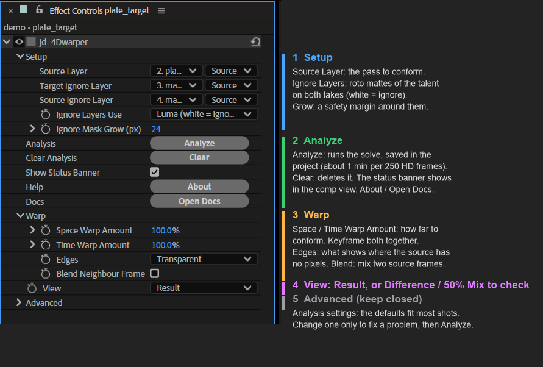

# jd_4Dwarper user guide

jd_4Dwarper conforms one motion-control pass (the **source**) to another (the **target**). It fits the source to the
target in **time** (sub-frame, the offset may drift along the shot) and in **space** (a homography per frame, plus a
local warp for parallax). It follows the **set**, never the talent.

## Quick start
1. Put both passes in one comp. Apply **jd_4Dwarper** to the **target** layer.
2. In **Setup**, pick the **Source Layer**. Hide the source layer (turn off its eye).
3. Optional, recommended with people in shot: roto the talent on both takes and pick the mattes as
   **Target Ignore Layer** and **Source Ignore Layer**.
4. Press **Analyze**. A progress dialog shows the progress. Esc or Cancel stops it.
5. Set **View** to **Difference (exposure matched)** to check the fit, then back to **Result**.

The analysis is saved in the project. The render only reads it, so rendering is fast and safe with multi-frame
rendering.

## The status banner
A strip at the top of the layer in the comp and layer views. It is never rendered.

| Banner | Meaning | What to do |
|---|---|---|
| grey: not analysed | No analysis yet | Pick the Source Layer, press Analyze |
| green: ready | Analysis done: number of frames and time offset range (source minus target, in frames). "Held the last source frame for N frames": the target needs source frames past the source take's out point, so the last frames show the take's last frame, warped to follow the set | Nothing, or extend the source take |
| orange: needs re-analysis | Setup or Advanced settings changed after Analyze, or the analysis comes from an older version | Press Analyze |
| red: failed | Analyze stopped: the reason and what to do are in the banner | See Troubleshooting |

Turn it off with **Show Status Banner**. Note: changing a **layer** (Source Layer, Ignore Layers) does not turn the
banner orange. Press Analyze after changing layers.

## Controls

### Setup
| Control | What it does |
|---|---|
| Source Layer | The pass to conform to this layer. Must have the same pixel size as the target (precompose it if not). Only frames inside its in and out points are used. |
| Target Ignore Layer | A matte of what the solve must ignore on the target: the talent, moving props. |
| Source Ignore Layer | The same, for the source take. |
| Ignore Layers Use | **Luma** (white = ignore) or **Alpha** (opaque = ignore). |
| Ignore Mask Grow (px) | Grows the ignore mattes, in full-resolution pixels (default 24). It covers motion blur and roto slop. |

### Analyze
| Control | What it does |
|---|---|
| Analyze | Runs the analysis over the target layer's in and out points. About 1 minute for 250 HD frames on a 24-thread CPU. |
| Clear | Deletes the analysis. The layer then shows unchanged. |
| Show Status Banner | Shows the banner in the comp and layer views. |
| About | Version and a quick start. |
| Open Docs | Opens this guide in the browser. |

### Warp
| Control | What it does |
|---|---|
| Space Warp Amount | 0 to 100 %. How far the source is moved onto the target. 0 % = the source frame unwarped. |
| Time Warp Amount | 0 to 100 %. How far the source is moved in time. 0 % = the source frame at the same time as the target. |
| Edges | Where the source has no pixels (it is often framed tighter): **Transparent** (default, the comp below shows through), **Show Target**, or **Extend Source Edge** (smears the border). |
| Blend Neighbour Frames | Off (default): the nearer whole source frame, sharpest. On: mixes the two source frames around the solved time, each with its own warp. Smoother motion, softer image. |

Keyframing the Amounts: **keyframe both together.** Time Warp Amount below 100 % with Space Warp Amount at 100 %
applies a warp solved for a different source frame, so it does not fit. Both at 0 % show the source layer untouched.
A ramp from 0 to 100 % on both slides the source smoothly into place, with no jumps.

### View
| Option | Shows |
|---|---|
| Result | The conformed source. |
| Difference (exposure matched) | The difference with the target after matching exposure. Black = aligned. Use it to check the fit. |
| 50% Mix | Half source, half target. |
| Difference (plain) | The raw difference, no exposure match. |
| Ignored Zones | The Target Ignore Layer over the target, to check the mattes. |

### Advanced (collapsed)
The defaults fit most shots. Change these only if the result is wrong somewhere. Every change needs a new Analyze.

| Control | Default | What it does |
|---|---|---|
| Solve | Time + Space | Or Space only (same timing) or Time only (same framing). |
| Time Search Range (frames) | 8 | How far the source may be offset in time, plus or minus. |
| Analysis Width (px) | 640 | Frames are analysed at about this width. Bigger is slower, rarely better. |
| Local Warp | on | A smooth local warp on top of the homography, for parallax. |
| Local Warp Smoothness (%) | 25 | Higher = stiffer local warp. |
| Analysis Region Top Left / Bottom Right | whole frame | Only the rectangle between the two points is measured. |
| Auto Ignore Changes | off | Finds changed content by itself. The Ignore Layers work better. |
| Hold Time After Frame / Hold From Layer Frame | off | Keeps the time offset fixed after a layer frame (for a section where the set is hard to see). |
| Perspective Stiffness, Scale / Rotation Stiffness | 1, 0.5 | Keeps the warp close to the shot's average warp. Not used when Ignore Layers are set, unless **Use Stiffness With Ignore Layers** is on. |
| Affine Only In Range, From / To Layer Frame | off | No perspective change in that frame range (for a section with little set in view). |

## The mask workflow
The solve must follow the set. People and moving props differ between takes and pull the fit.
1. Roto the talent (and anything that moves differently between takes) on **both** takes. Rough mattes are fine.
   Make them a bit larger than the talent, or use **Ignore Mask Grow**.
2. Render or precompose each matte at the size of its plate: white = ignore (Luma) or opaque = ignore (Alpha).
3. Pick them as Target Ignore Layer and Source Ignore Layer. Hide the matte layers.
4. Check with **View: Ignored Zones**, then Analyze.

With masks, the stiffness prior is off by default: tests showed the masks work better alone.

## Troubleshooting
| Problem | Fix |
|---|---|
| failed (no source layer) | Pick a Source Layer. |
| failed (size mismatch) | Precompose the source to the target's size. |
| failed (source outside the shot) | Move the Source Layer so it overlaps this layer in time. |
| failed (out of memory) | Lower Analysis Width or trim the layer. |
| Set slides where the talent is | Add Ignore Layers on both takes, or grow them. |
| Wrong frames or CG at the end of the shot | Set the Source Layer's out point **before** any frame that is not real footage, including the first frame of a dissolve or a cut. Only frames inside the in and out points are used. |
| Smeared borders | Edges = Transparent or Show Target. |
| Motion stops on the last frames | The target needs source frames past the source take's out point: the take's last frame is held (the banner says how many frames). Extend the source take if you can. |
| Not sure what After Effects fed the solve | Create the folder `%TEMP%\jd_4Dwarper_dump` and press Analyze: the frames and masks as analysed, the frame ranges and the solved times are written there. Delete the folder to switch it off. |
| Analyze takes long | Trim the layer to the frames you need. A log is in `%TEMP%\jd_4Dwarper_analyze.log`. |

## Known limits
- **Near-depth parallax**: objects much closer to the camera than the rest of the set (a close-up foreground) can
  keep a few pixels of error. The local warp is smooth by design.
- **Uncovered border**: where the source take has no pixels, nothing is invented (see Edges).
- **Time offset limit**: the offset is searched within plus or minus Time Search Range.
- **End of the source take**: where the target needs source frames the take does not have, the last frame is
  held. Its motion stops; the warp still follows the set.
- Same pixel size for source and target. Tested at 23.976 fps, 1920x1080, After Effects 2026, Windows.
- Changing layers does not mark the analysis as stale: press Analyze yourself.
