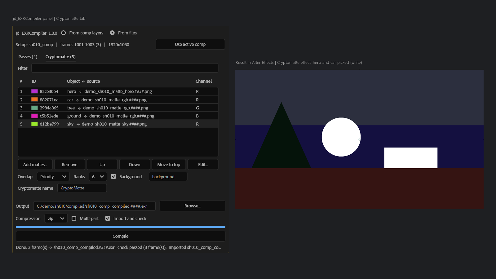
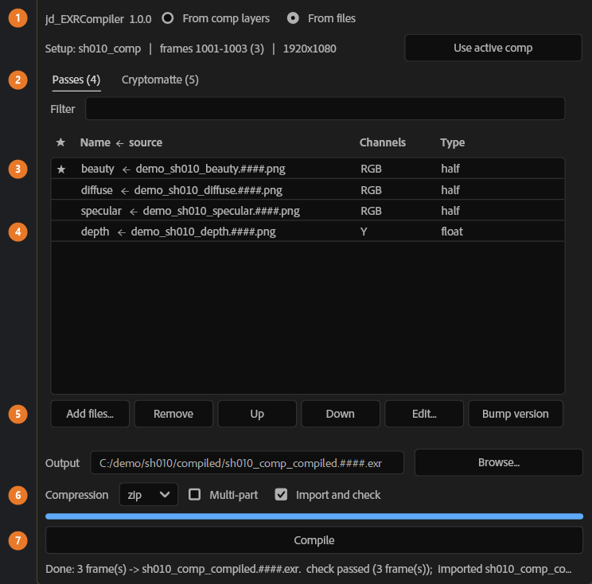
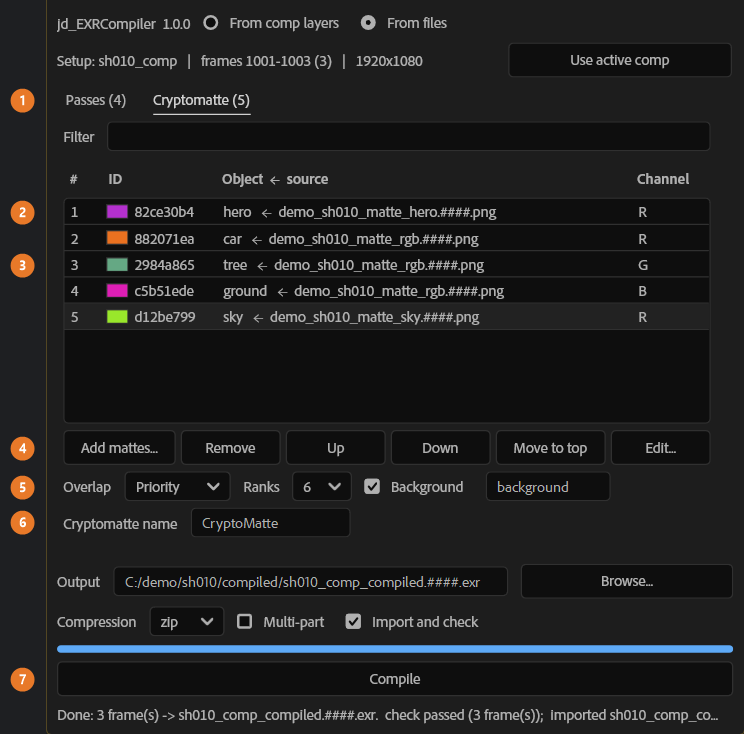
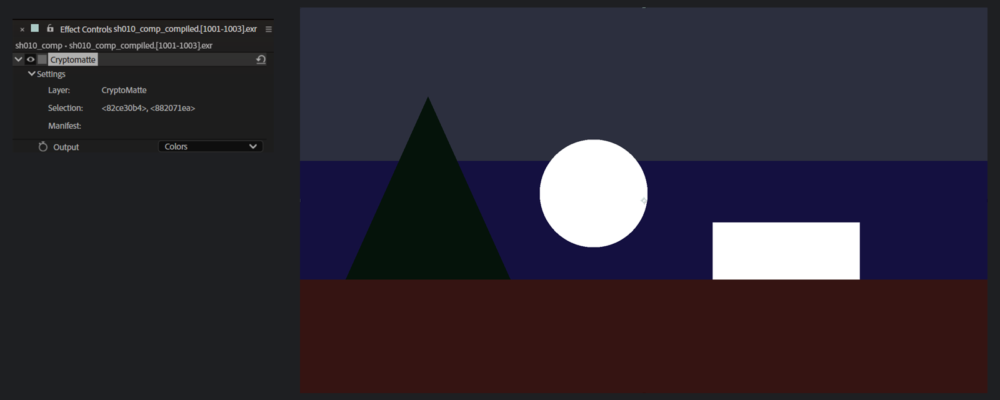
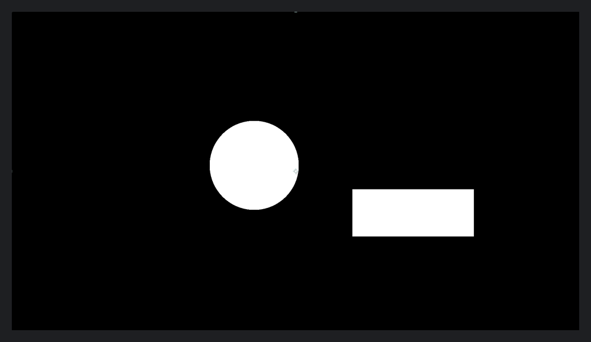

# jd_EXRCompiler

An After Effects panel that merges separate render passes into **one multi-layer EXR**
and builds a **Cryptomatte** from black-and-white or RGB mattes — two things After
Effects can read but can't write.

Pick passes and mattes from files on disk or straight from layers in a comp, set the
order, press **Compile**. A small companion program, `jd_exrc`, writes the files; the
panel runs it for you, then imports the result with AE's own Cryptomatte effect already
on it. The Cryptomatte follows the published specification, so Nuke, Fusion and Blender
can pick from it too.



## Features

- **Multi-layer EXR out of AE.** Merge any number of passes into one EXR: bit-exact copies,
  half or float per layer, lossless compression, camera metadata carried over from the main pass.
- **Cryptomatte from mattes.** Black-and-white mattes, RGB mattes split into three objects,
  luminance, or comp layers by alpha. IDs, ranks and manifest follow the specification.
- **Overlaps handled.** Priority order with up/down and move to top; soft edges stay soft where
  objects meet.
- **Files or comp layers.** Sequences on disk (EXR, PNG, TIFF) or layers rendered on the fly,
  mixed in one setup.
- **One click back into AE.** *Import and check* validates the file, imports it and adds the
  Cryptomatte effect.
- **Made for versions.** Setups are saved per comp; *Bump version* repoints `_v04` → `_v05`.
- **Command line too.** `jd_exrc` runs the same jobs in batch or in a pipeline.

---

## Requirements

- After Effects on **Windows** (tested on 2026). `jd_exrc` is a Windows program for now.
- **Allow Scripts to Write Files and Access Network** turned on
  (**Edit → Preferences → Scripting & Expressions**). The panel tells you if it is off.
- For **From comp layers** only: a one-time output-module template, see
  [From comp layers](#from-comp-layers).

## Install

Download `jd_EXRCompiler-<version>-win64.zip` from the repository's
[Releases](https://github.com/jdel0nAY/ae-tools/releases) page and copy two files from it
into After Effects' `ScriptUI Panels` folder:

```
C:\Program Files\Adobe\Adobe After Effects <version>\Support Files\Scripts\ScriptUI Panels\
```

- `jd_EXRCompiler.jsx`
- `jd_exrc.exe` (next to the `.jsx`, or in a folder called `jd_EXRCompiler` next to it)

Restart After Effects and open **Window → jd_EXRCompiler.jsx**. It docks like any panel.
It also runs as a floating window from **File → Scripts → Run Script File…**.

## Quick start

1. Open your comp and press **Use active comp**. The setup is saved per comp.
2. **Passes** tab → **Add files…** → pick one frame of each pass. Sequences are found
   automatically: `name.1001.exr` becomes `name.####.exr`.
3. **Cryptomatte** tab → **Add mattes…** → pick one frame of each matte. An RGB matte asks
   whether to split it into three objects (R, G, B) and lets you name each one.
4. Check the **Output** path and press **Compile**.

With **Import and check** on, the result is checked against the Cryptomatte specification,
imported as a sequence and, if a comp is active, added to it with the Cryptomatte effect.

---

## Two sources

The switch at the top of the panel sets where new rows come from. File rows and layer rows
can be mixed in one setup.

### From files

Each file or sequence is one row. Inputs can be EXR (any layers, multi-part included), PNG
(8 or 16 bit) or TIFF (8/16-bit integer, 16/32-bit float). Values go through untouched — no
colour conversion.

Names are read from the file names, without frame numbers and versions. Files added
together also lose the prefix they share:

```
sh010_comp_v04_diffuse.1001.exr    ->  diffuse
sh010_comp_v04_specular.1001.exr   ->  specular
```

A file added on its own keeps its full name; rename the row with **Edit…**.

### From comp layers

Select layers in your comp and press **Add selected** on either tab.

- **Passes:** each layer becomes a pass, named after the layer.
- **Cryptomatte:** each layer becomes an object from its **alpha**, or its **luminance** if it
  is footage without alpha. Choose *RGB matte* to split a layer into R, G and B objects.

On **Compile** each of those layers is rendered on its own to a temporary sequence, using a
temporary copy of the comp with only that layer switched on (cameras, lights and its track
matte stay on) at the same size, pixel aspect, frame rate and work area. Your comps are not
changed; the temporary comps and render-queue items are removed afterwards and the rest of
your render queue is left as it was. The panel then offers to delete the temporary renders,
which sit in a `_jd_exrc_tmp_…` folder next to the output.

**One-time setup.** Make one output-module template by hand
([why](#why-a-template)):

1. **Edit → Templates → Output Module…** → **New**, and name it **`jd_exrc EXR32`**.
2. Format **OpenEXR**; in Format Options choose **32-bit float** and a lossless compression
   such as **ZIP**.
3. Channels **RGB + Alpha**, Depth **Floating Point+**, Color **Premultiplied**.
4. On the **Color Management** tab tick **Preserve RGB** — otherwise AE converts the values
   to linear light.

The panel only uses this template; it never creates or changes templates. Without it, Compile
stops and shows these steps. Before rendering any layer, the panel renders a tiny calibration
frame with the template and stops if the values came back changed, so a wrong setting can't
produce wrong mattes.

---

## The two tabs

### Passes



1. **Source** — new rows come from files on disk or from layers in the active comp.
2. **Tabs** — the row count of each list is in its label.
3. **Main pass (★)** — written as plain `R G B A`.
4. **A data pass** — here a depth pass, read from one channel and written as 32-bit float.
5. **List buttons** — add, remove, reorder, edit, and **Bump version** for the selected rows.
6. **Output options** — compression, multi-part, and *Import and check*.
7. **Compile** — one click; the status line reports frames written and the check result.

| Column | Meaning |
| --- | --- |
| ★ | The main layer, written as plain `R G B A` (what every app shows by default). One per file. |
| Name ← source | The layer name in the output (`diffuse.R`, `diffuse.G`…) and where it comes from |
| Channels | What to copy: `RGBA`, `RGB`, `Z`, or a mapping such as `R->Z` |
| Type | `half` for colour passes, `float` for depth, position, normals, motion and IDs |

- **Edit…** (or double-click) changes a row's name, source, layer inside the file, channels,
  type and the ★.
- **Bump version** moves the selected rows to the next version (`_v04` → `_v05`, in the file
  name and in a `v04` folder), only when that version exists on disk. Press Compile again and
  you're done.

### Cryptomatte



1. **Tabs** — switch between Passes and Cryptomatte.
2. **Priority list** — the top row wins where mattes overlap. The chip is the object's ID colour.
3. **An RGB matte split in three** — `car`, `tree` and `ground` come from the R, G and B
   channels of one file.
4. **List buttons** — including **Move to top** for priority.
5. **Overlap, ranks and background** — see the tables below.
6. **Cryptomatte name** — the layer name AE's Cryptomatte effect lists.
7. **Compile** — writes the passes and the Cryptomatte into one file.

| Column | Meaning |
| --- | --- |
| # | Priority. The top row wins where mattes overlap. |
| ID | The object's colour chip and Cryptomatte ID |
| Object ← source | The object's name and where its matte comes from |
| Channel | `R`, `G`, `B`, `A`, or `L` (luminance). A black-and-white matte uses `R`. |

Under the list:

| Setting | Default | Notes |
| --- | --- | --- |
| Overlap | Priority | How overlapping mattes share a pixel, see below |
| Ranks | 6 | How many objects one pixel can hold |
| Background | off | Adds an object covering whatever no matte covers |
| Cryptomatte name | `CryptoMatte` | The layer name AE's Cryptomatte effect lists |

Overlap modes:

| Mode | What happens where mattes overlap |
| --- | --- |
| **Priority** | Higher rows win; each matte only gets what the ones above left. Soft edges stay soft, and two objects meeting at an antialiased edge keep their full coverage. |
| **Holdout** | Classic multiply: each matte is multiplied by the inverse of every matte above. Darkens shared edges. |
| **Normalise** | No priority; where mattes add up to more than 1 they share the pixel. |

Object names must be unique; the panel tells you if two names would get the same ID.

### The result

With **Import and check** on, the compiled EXR lands in your comp with AE's Cryptomatte
effect. Pick objects in the viewer — here `hero` and `car`, shown with *Output: Colors*:



and with *Output: Matte Only*, the matte to use downstream:



### Output options

- **Compression:** `zip` (default), `zips`, `piz`, `rle` or `none` — all lossless, as
  Cryptomatte needs.
- **Multi-part:** one EXR part per layer. Off by default, because single-part files open
  everywhere.
- Use `####` in the output name for the frame number.

Setups are saved next to your project as `<project name>.jd_EXRCompiler.json`, one setup per
comp, every time you change something. Projects that were never saved use a file in your user
preferences folder until they are.

---

## jd_exrc on its own

The panel's companion program also works from the command line, for batch jobs and
pipelines.

```
jd_exrc crypto -o crypto.####.exr --matte hero=hero.####.png --matte car,tree,sky=rgb.####.exr:RGB
jd_exrc merge  -o out.####.exr --layer beauty=beauty.####.exr:RGBA --layer depth=z.####.exr:R->Z
jd_exrc run job.json --check
jd_exrc check file.exr
jd_exrc info file.exr
```

`merge` and `crypto` take the same options, so one command can write passes and a Cryptomatte
together. `run` takes a JSON job file — the panel writes one per compile, and
[SPEC.md](SPEC.md#5-job-file-and-cli) describes the format.

| Option | Meaning |
| --- | --- |
| `--layer NAME=FILE[:MAP]` | A pass; `MAP` is `RGBA`, `RGB`, `A`, `Y`, `Z` or `SRC->DST[,…]` |
| `--matte NAMES=FILE[:CH]` | Cryptomatte objects; `a,b,c=file:RGB` splits one file in three; `L` = luminance |
| `--mode priority\|holdout\|normalise` | Overlap mode (default `priority`) |
| `--name`, `--ranks`, `--background` | Cryptomatte name, ranks, background object |
| `--frames A-B`, `--hold-missing` | Frame range; reuse the nearest frame when one is missing |
| `--compression`, `--multipart` | Output compression and layout |
| `--check` | Check every frame against the Cryptomatte specification as it is written |
| `--json-log`, `--log-file PATH` | Machine-readable progress, also written to a file |

`jd_exrc --help` lists everything. Exit codes: 0 ok, 1 check failed, 2 bad job, 3 file error.

### Build from source

Needs Visual Studio 2022 (C++ and CMake) and vcpkg, which Visual Studio includes.

```
cd cli
vcpkg install --triplet x64-windows-static-md --x-install-root=vcpkg_installed
cmake -S . -B build -G "Visual Studio 17 2022" -A x64 -DCMAKE_PREFIX_PATH=%CD%/vcpkg_installed/x64-windows-static-md
cmake --build build --config Release
ctest --test-dir build -C Release
```

The panel's logic has tests too: `node panel/tests/test_core.js path\to\jd_exrc.exe`.
GitHub Actions builds the release zip on every change ([workflow](../.github/workflows/jd_EXRCompiler.yml)).

---

## Why a template

Worth documenting, because After Effects gives no error that points at it.

Comp-layers mode has to render each layer to a 32-bit float file before `jd_exrc` can read
it. In After Effects 2026 a script can add render-queue items and set an output module's
file name, but **Format**, **Depth** and **Channels** report as read-only through
`setSettings()` — even with the exact names and numbers AE itself lists as allowed. A float
TIFF set up by script comes out 8-bit, and none of AE's built-in output-module templates is
OpenEXR or float with alpha. A template made by hand is the one route that works, so the
panel uses it by name and checks it with a calibration frame instead of trusting it.

The output module's colour management matters too: without **Preserve RGB**, unmanaged and
sRGB-working-space projects get their values converted to linear light on the way out (a
matte at 0.5 lands at 0.214). OCIO projects write raw values either way.

A related quirk: AE's `system.callSystem()` doesn't pass a program's output back, so the
panel runs `jd_exrc --log-file` and reads the log to show progress and errors.

## How it was checked

- `jd_exrc`: 32 core tests and an end-to-end test covering EXR, PNG and TIFF inputs,
  sequences, job files, multi-part output and every exit code.
- A Cryptomatte rendered by Blender, split into per-object mattes and rebuilt by `jd_exrc`,
  comes back bit for bit — same IDs, coverage and manifest ([`tools/`](tools/)).
- The panel: 188 logic tests, and both sources tested in After Effects 2026 in unmanaged,
  working-space and OCIO projects. Values pass through raw, and picking gives the right matte
  per object.

## Known limitations

- Windows only for now.
- After Effects is busy while layers render and while `jd_exrc` runs. Long jobs run in up to
  10 parts so the progress bar moves, but you can't work in AE until it finishes.
- AE's Cryptomatte effect lists picked objects as hex IDs such as `<a94a3318>`, not names —
  it does the same for files from 3D renderers. The mattes are correct.
- If the Cryptomatte effect doesn't show the right layer, pick it in the effect's Layer menu.
- From comp layers needs the [one-time template](#from-comp-layers).

## Version

**1.0.1** — the panel reads TIFF passes and mattes; illustrated guide.

**1.0.0** — initial release. See [CHANGELOG.md](CHANGELOG.md).

Design notes: [SPEC.md](SPEC.md). Third-party libraries in `jd_exrc.exe`:
[THIRD_PARTY.md](THIRD_PARTY.md). MIT licence, like the rest of this repository.
